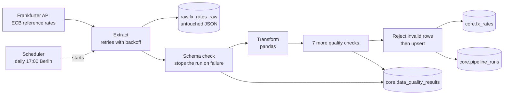

# FX Rates Pipeline

[](https://github.com/thanuz-26/fx-pipeline/actions/workflows/ci.yml)
[](LICENSE)

A containerized Python pipeline that downloads the daily ECB euro reference
rates from the Frankfurter API, checks them with eight data quality checks, and
loads them into PostgreSQL in a way that is safe to run again and again. Every
run and every check result is recorded in the database. The whole project runs
in Docker Compose and is tested automatically on every push.

## Business story

A risk team has exposures in many currencies and needs reliable, clean exchange
rates in one place to convert them to EUR. This pipeline gives them a single
PostgreSQL database with validated daily rates for USD, GBP, CHF, JPY and INR
against the euro. It also keeps the untouched API response for auditing, a log
of every run, and the result of every data quality check, so anyone can see
what was loaded, when, and how good the data was.


## Quick start

You need [Docker Desktop](https://www.docker.com/products/docker-desktop/) (or
Docker Engine with the Compose plugin) and Git.

```bash
git clone https://github.com/thanuz-26/fx-pipeline.git
cd fx-pipeline
cp .env.example .env      # on Windows PowerShell: copy .env.example .env
docker compose up
```

Edit `.env` first if you want your own database password (the default is a
placeholder). The first start builds the image, which takes a minute or two.

What happens on start:

1. PostgreSQL starts and creates the `raw` and `core` schemas and their tables
   from the scripts in `sql/`.
2. The pipeline runs once and loads the last 14 days of rates.
3. A scheduler container starts and runs the pipeline daily at 17:00
   Europe/Berlin while Docker is running.

`docker compose up` keeps running in the foreground. Press `Ctrl+C` to stop it,
or add `-d` to run it in the background.

### See the result

```bash
docker compose exec postgres psql -U fx_user -d fx_db -c \
  "SELECT rate_date, quote_currency, rate FROM core.fx_rates ORDER BY rate_date DESC, quote_currency LIMIT 10;"
```

### Handy commands

| Command | What it does |
|---|---|
| `make up` | Start the database in the background |
| `make run` | Rebuild the image and run the pipeline once |
| `make test` | Run the tests (needs the development libraries, see below) |
| `make down` | Stop and remove the containers (your data stays in the volume) |


## Architecture



The untouched API response is stored before any check runs, so it is kept even
when a run is stopped. Every run and every check result is recorded in the
database.

### Docker Compose services

| Service | What it does |
|---|---|
| `postgres` | PostgreSQL 16 with a named volume, a health check, and the scripts in `sql/` that create the tables on first start |
| `pipeline` | Runs the pipeline once when the stack starts, then exits |
| `scheduler` | Stays running and starts the pipeline daily at 17:00 Europe/Berlin (restarts itself unless stopped) |


## Tech stack

| Area | Tools |
|---|---|
| Language | Python 3.12 |
| Data handling | `requests` (API calls with timeouts and retries), `pandas` (transform) |
| Database | PostgreSQL 16, `SQLAlchemy` and `psycopg2` |
| Configuration | Environment variables, read with `python-dotenv` (`.env` is never committed) |
| Scheduling | `APScheduler` in its own container |
| Containers | Docker and Docker Compose, with a `Makefile` for short commands |
| Quality | `pytest` and `pytest-cov` (tests and coverage), `ruff` 0.17.4 (linting and formatting) |
| Automation | GitHub Actions runs ruff and the tests on every push |

## Database model

Two schemas keep untouched data apart from trusted data: `raw` holds what the
API sent, and `core` holds the validated rates and the records of how they got
there.

| Table | Purpose | Key points |
|---|---|---|
| `raw.fx_rates_raw` | The untouched API response as `JSONB`, with `loaded_at` | Append-only: every run adds a row, nothing is overwritten |
| `core.fx_rates` | One validated rate per date and currency pair | Primary key `(rate_date, base_currency, quote_currency)`; `rate` is `NUMERIC(18,8)` with `CHECK (rate > 0)`; `source` and `loaded_at` columns |
| `core.pipeline_runs` | One row per pipeline run | `status` is `running`, `success` or `failed`; counts of rows fetched, loaded and rejected; `error_message` |
| `core.data_quality_results` | One row per check per run | `status` is `pass` or `fail`; `failed_count` and `details`; foreign key to `core.pipeline_runs` |

Design choices:

- **Idempotent load.** Loading uses `INSERT ... ON CONFLICT DO UPDATE` on the
  primary key of `core.fx_rates`, so running the pipeline twice never creates
  duplicates.
- **`NUMERIC` instead of a float** for rates, to avoid rounding errors.
- **Rules live in the database too.** The primary key, the `CHECK` on `rate`,
  the allowed status values and the foreign key protect the data even if the
  application code has a bug.
- **Raw data is kept** so a bug in the transform can be fixed and the data
  reprocessed without calling the API again.


  
## Data quality checks

Eight checks run on every batch. Each one is a small, separately tested
function. What happens on a failure depends on the kind of problem:

| Check | What it tests | If it fails |
|---|---|---|
| `schema` | The response is a list of records with `date`, `base` and `quote` as text and `rate` as a number | **Stop the run** |
| `completeness` | Every requested currency is present for each date in the batch | **Stop the run** |
| `row_count` | The batch has at least one row per requested currency | **Stop the run** |
| `missing_values` | No null or blank values in the required columns | **Reject the row** |
| `duplicates` | No repeated `(rate_date, base_currency, quote_currency)` key; the first row is kept | **Reject the extra rows** |
| `rate_positive` | Every rate is greater than zero | **Reject the row** |
| `daily_change` | No rate moves more than 5% (default) from the previous date of the same pair | **Warn and continue** |
| `freshness` | The latest date is at most 4 days old (default), which allows for weekends | **Warn and continue** |

How failures are handled:

- **Stop the run:** the whole batch is untrustworthy. Nothing is loaded into
  `core`, the run is recorded as `failed` with the reason, and the untouched
  response stays in `raw.fx_rates_raw`.
- **Reject the row:** one invalid row does not taint the others. The bad rows
  are removed and counted in `rows_rejected`, and the rest is loaded.
- **Warn and continue:** the data may be correct but unusual, so it is loaded
  and a warning is logged.

Every verdict is saved in `core.data_quality_results` together with the run it
belongs to. A warning-level check that fails is stored as `fail`, because the
table only has `pass` and `fail`.


## How scheduling works

The `scheduler` service runs the same image as the pipeline. It uses
[APScheduler](https://apscheduler.readthedocs.io/) to start the pipeline once a
day at **17:00 Europe/Berlin**. The ECB publishes its reference rates around
16:00 CET, so the run starts an hour later. Naming the time zone makes the run
follow summer and winter time. The time can be changed with `SCHEDULE_HOUR`,
`SCHEDULE_MINUTE` and `SCHEDULE_TIMEZONE` in `.env`.

Every run fetches a **rolling window** of the last 14 days (`FX_WINDOW_DAYS`
changes the length). Because the load is an upsert, the overlap is harmless,
and a day that was missed is repaired by the next run. A late run is also
allowed to run if the computer wakes up within an hour of the set time.

### Running it by hand

```bash
make run                  # rebuild the image and run the pipeline once
```

To load a longer history, run a date range (a fresh database only holds the
last 14 days until you do):

```bash
docker compose run --rm pipeline python -m fx_pipeline.main --start 2026-01-01 --end 2026-10-30
```

### What was verified, and a known limit

- The schedule logic is covered by unit tests that use fixed times and never
  wait for the clock.
- In a test with a temporary run time, the scheduler started a real run by
  itself at the set time and recorded it in `core.pipeline_runs`.
- **Known limit:** the scheduler runs only while Docker is running on a computer
  that is awake. Docker Desktop runs containers in a virtual machine, and when a
  laptop sleeps, the machine and the scheduler's timer pause with it. The
  17:00 run on one evening was missed this way, so a sleeping laptop can miss or
  delay runs. The rolling window repairs the data on the next run. Running the
  stack on an always-on server would remove the limit.


  
## Tests and code quality

There are 78 automated tests. GitHub Actions runs ruff and the full suite on
every push, including the database tests (against a PostgreSQL service
container), and measures about 96% coverage.

| Area | How it is tested |
|---|---|
| Transform, the eight quality checks, the reject step | Unit tests with small fake data |
| API extraction | Unit tests with a fake `requests.get`: request parameters, retries with backoff, giving up, and no retry on a 4xx error |
| Logging and scheduler | Unit tests; the schedule is checked with fixed times and never waits for the clock |
| Load and run tracking | Integration tests against a temporary PostgreSQL database that each test creates and drops |
| Whole pipeline (`main.py`) | A fake API and a temporary database: success, rejected rows, stop on a schema failure, stop on a missing currency, and an API failure |

To run them locally (the database tests need PostgreSQL, so start it first and
create `.env` as in the quick start):

```bash
python -m venv .venv
.venv\Scripts\activate        # Linux/macOS: source .venv/bin/activate
pip install -r requirements-dev.txt
docker compose up -d postgres
pytest
```

If no database is reachable, the 18 database tests are skipped instead of
failing. To run only the tests that need no database:

```bash
pytest -m "not integration"
```

Code style is checked with ruff:

```bash
ruff check src tests
ruff format --check src tests
```


## Example output

Real output from a local run (timestamps are UTC). The latest rates:

```text
 rate_date  | quote_currency |     rate     
------------+----------------+--------------
 2026-11-13 | CHF            |   0.92660000
 2026-11-13 | GBP            |   0.83559000
 2026-11-13 | INR            | 104.15750000
 2026-11-13 | JPY            | 176.83000000
 2026-11-13 | USD            |   1.10520000
 2026-11-12 | CHF            |   0.92320000
 2026-11-12 | GBP            |   0.83595000
 2026-11-12 | INR            | 104.21180000
 2026-11-12 | JPY            | 176.96000000
 2026-11-12 | USD            |   1.10810000
```

The run log in `core.pipeline_runs`. The runs with 55 rows each fetched the
14-day window (11 publication days × 5 currencies); one run filled a gap with a
date range:

```text
 run_id |          started_at           | status  | rows_fetched | rows_loaded | rows_rejected 
--------+-------------------------------+---------+--------------+-------------+---------------
     15 | 2026-11-16 00:00:02.036207+00 | success |           50 |          50 |             0
     14 | 2026-11-15 23:37:29.771264+00 | success |           55 |          55 |             0
     13 | 2026-11-15 15:33:54.2427+00   | success |           55 |          55 |             0
     12 | 2026-11-15 14:51:47.87594+00  | success |           55 |          55 |             0
     11 | 2026-11-15 13:45:27.238285+00 | success |           30 |          30 |             0
```

The verdicts of the latest run in `core.data_quality_results`:

```text
   check_name   | status | failed_count 
----------------+--------+--------------
 schema         | pass   |            0
 completeness   | pass   |            0
 row_count      | pass   |            0
 missing_values | pass   |            0
 duplicates     | pass   |            0
 rate_positive  | pass   |            0
 daily_change   | pass   |            0
 freshness      | pass   |            0
```

The rates give the number of units of the quote currency per euro, so a USD
exposure is converted to EUR by dividing by the EUR/USD rate:

```text
 rate_date  |  eur_usd   | eur_value_of_1m_usd 
------------+------------+---------------------
 2026-11-13 | 1.10520000 |           904813.61
```

That is 1,000,000 USD ÷ 1.1052 = 904,813.61 EUR on 13 November 2026.


## Limitations

- **The scheduler needs an awake computer.** It runs only while Docker is
  running. When a laptop sleeps, the virtual machine and the scheduler's timer
  pause, and a run can be missed or delayed. The rolling window repairs the data
  on the next run.
- **Five currencies:** USD, GBP, CHF, JPY and INR against the euro. More can be
  added to the list in `src/fx_pipeline/main.py`.
- **History needs one manual run.** A fresh database holds only the last 14
  days; older data (or a gap older than the window) is loaded with a date range
  (see "How scheduling works").
- **Two checks have blind spots.** `completeness` only looks at dates that are
  in the batch, so a date that is missing entirely is not noticed. `daily_change`
  compares rates inside the batch only, not with older rows in the database.
- **No alerts.** A failed run is recorded in `core.pipeline_runs` and in the
  logs, but nobody is notified.
- **The log file is not kept.** It lives inside the container; the console log
  is available with `docker compose logs`.
- **Informational rates.** The ECB publishes these rates for information and
  discourages using them for transactions, so the data suits reporting and risk
  analysis, not trading.
- **Local setup only.** Secrets live in `.env`, and there is no cloud
  deployment.

## Future improvements

- Run the stack on an always-on server, or add a heartbeat so a sleeping
  computer cannot delay the daily run.
- Send an alert (email or chat message) when a run fails.
- Add more currencies, and a daily mode that fetches from the newest stored
  date.
- Compare the daily change with older rows in the database, and check for dates
  that are missing entirely.
- Move scheduling to an orchestrator such as Airflow, and deploy to the cloud.
- Reuse the database for a Power BI credit-risk dashboard and an SQL assistant
  (ideas, not built yet).