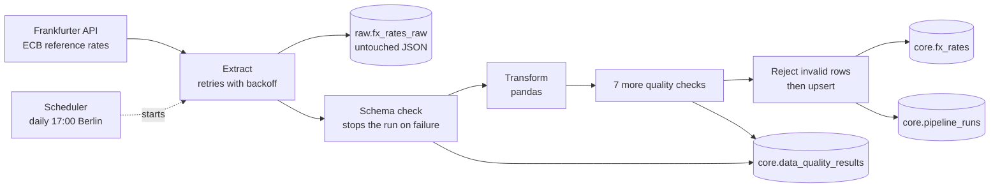

# FX Rates Pipeline

[](https://github.com/thanuz-26/fx-pipeline/actions/workflows/ci.yml)
[](LICENSE)

A containerized Python pipeline that downloads the daily ECB euro reference
rates from the Frankfurter API, checks them with eight data quality checks, and
loads them into PostgreSQL in a way that is safe to run again and again. Every
run and every check result is recorded in the database. The whole project runs
in Docker Compose and is tested automatically on every push.

## Business story

A risk team has exposures in many currencies and needs reliable, clean exchange
rates in one place to convert them to EUR. This pipeline gives them a single
PostgreSQL database with validated daily rates for USD, GBP, CHF, JPY and INR
against the euro. It also keeps the untouched API response for auditing, a log
of every run, and the result of every data quality check, so anyone can see
what was loaded, when, and how good the data was.


## Quick start

You need [Docker Desktop](https://www.docker.com/products/docker-desktop/) (or
Docker Engine with the Compose plugin) and Git.

```bash
git clone https://github.com/thanuz-26/fx-pipeline.git
cd fx-pipeline
cp .env.example .env      # on Windows PowerShell: copy .env.example .env
docker compose up
```

Edit `.env` first if you want your own database password (the default is a
placeholder). The first start builds the image, which takes a minute or two.

What happens on start:

1. PostgreSQL starts and creates the `raw` and `core` schemas and their tables
   from the scripts in `sql/`.
2. The pipeline runs once and loads the last 14 days of rates.
3. A scheduler container starts and runs the pipeline daily at 17:00
   Europe/Berlin while Docker is running.

`docker compose up` keeps running in the foreground. Press `Ctrl+C` to stop it,
or add `-d` to run it in the background.

### See the result

```bash
docker compose exec postgres psql -U fx_user -d fx_db -c \
  "SELECT rate_date, quote_currency, rate FROM core.fx_rates ORDER BY rate_date DESC, quote_currency LIMIT 10;"
```

### Handy commands

| Command | What it does |
|---|---|
| `make up` | Start the database in the background |
| `make run` | Rebuild the image and run the pipeline once |
| `make test` | Run the tests (needs the development libraries, see below) |
| `make down` | Stop and remove the containers (your data stays in the volume) |


## Architecture



The untouched API response is stored before any check runs, so it is kept even
when a run is stopped. Every run and every check result is recorded in the
database.

### Docker Compose services

| Service | What it does |
|---|---|
| `postgres` | PostgreSQL 16 with a named volume, a health check, and the scripts in `sql/` that create the tables on first start |
| `pipeline` | Runs the pipeline once when the stack starts, then exits |
| `scheduler` | Stays running and starts the pipeline daily at 17:00 Europe/Berlin (restarts itself unless stopped) |


## Tech stack

| Area | Tools |
|---|---|
| Language | Python 3.12 |
| Data handling | `requests` (API calls with timeouts and retries), `pandas` (transform) |
| Database | PostgreSQL 16, `SQLAlchemy` and `psycopg2` |
| Configuration | Environment variables, read with `python-dotenv` (`.env` is never committed) |
| Scheduling | `APScheduler` in its own container |
| Containers | Docker and Docker Compose, with a `Makefile` for short commands |
| Quality | `pytest` and `pytest-cov` (tests and coverage), `ruff` 0.17.4 (linting and formatting) |
| Automation | GitHub Actions runs ruff and the tests on every push |

## Database model

Two schemas keep untouched data apart from trusted data: `raw` holds what the
API sent, and `core` holds the validated rates and the records of how they got
there.

| Table | Purpose | Key points |
|---|---|---|
| `raw.fx_rates_raw` | The untouched API response as `JSONB`, with `loaded_at` | Append-only: every run adds a row, nothing is overwritten |
| `core.fx_rates` | One validated rate per date and currency pair | Primary key `(rate_date, base_currency, quote_currency)`; `rate` is `NUMERIC(18,8)` with `CHECK (rate > 0)`; `source` and `loaded_at` columns |
| `core.pipeline_runs` | One row per pipeline run | `status` is `running`, `success` or `failed`; counts of rows fetched, loaded and rejected; `error_message` |
| `core.data_quality_results` | One row per check per run | `status` is `pass` or `fail`; `failed_count` and `details`; foreign key to `core.pipeline_runs` |

Design choices:

- **Idempotent load.** Loading uses `INSERT ... ON CONFLICT DO UPDATE` on the
  primary key of `core.fx_rates`, so running the pipeline twice never creates
  duplicates.
- **`NUMERIC` instead of a float** for rates, to avoid rounding errors.
- **Rules live in the database too.** The primary key, the `CHECK` on `rate`,
  the allowed status values and the foreign key protect the data even if the
  application code has a bug.
- **Raw data is kept** so a bug in the transform can be fixed and the data
  reprocessed without calling the API again.